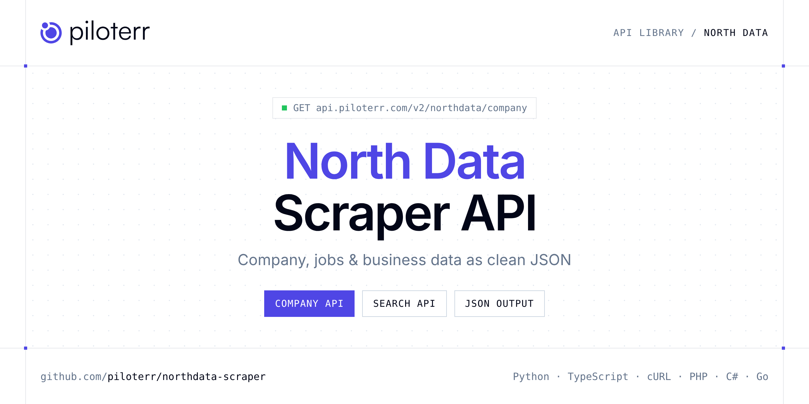

<p align="center">
  <a href="https://www.piloterr.com"></a>
</p>

# North Data Scraper API

[](https://discord.gg/CFj3ph8aHU) [](https://app.piloterr.com) [](https://app.piloterr.com/openapi) [](LICENSE)

The **Piloterr North Data Scraper API** lets you extract public data from North Data as **clean, structured JSON** — no proxies, headless browsers or HTML parsing to maintain. Endpoints available in production:

- **North Data Company API** — North Data company profile: register, address, financials and history (1 credit).
- **North Data Search API** — Search North Data companies and people by name.

Use it for lead generation, CRM enrichment, market mapping, investment research or job market analytics.

| Endpoint | Path | Credits | What you get |
|---|---|---|---|
| [North Data Company API](#north-data-company-api) | `/v2/northdata/company` | 1 | North Data company profile |
| [North Data Search API](#north-data-search-api) | `/v2/northdata/search` | 1 | Search North Data companies and people by name. Returns suggestion cards and pagination (1 credit). |

## Table of contents

- [How it works](#how-it-works)
- [North Data Company API](#north-data-company-api)
- [North Data Search API](#north-data-search-api)
- [Code examples in other languages](#code-examples-in-other-languages)
- [Practical use cases](#practical-use-cases)
- [Why Piloterr?](#why-piloterr)
- [FAQ](#faq)
- [Official SDKs](#official-sdks)
- [Related scrapers](#related-scrapers)
- [Support](#support)

## How it works

1. **Create a free Piloterr account** and copy your API key from the [dashboard](https://app.piloterr.com).
2. **Send a `GET` (or `POST`) request** to `https://api.piloterr.com/v2/...` with the header `x-api-key: YOUR_API_KEY`.
3. **Receive structured JSON** — Piloterr handles rendering, proxies, retries and parsing.

```bash
export PILOTERR_API_KEY="your-api-key"
pip install requests        # Python
# TypeScript: Node.js 18+ (native fetch), run with `npx tsx file.ts`
```

> Every endpoint accepts both `GET` (query string) and `POST` (JSON body with the same fields).

## North Data Company API

North Data company profile: register, address, financials and history (1 credit).

`GET | POST https://api.piloterr.com/v2/northdata/company` · **1 credit per request** · [Full reference](https://app.piloterr.com/openapi)

### Request parameters

| Parameter | Type | Required | Description |
|---|---|---|---|
| `query` | string | ✅ | Company name, North Data id, or a profile URL. |
| `countries` | string | — | ISO alpha-2, used only when query is a name. Same form as search: FR or FR,DE. |
| `domain` | string | — | fr (default), com or en, de. Ignored when query is a URL. |

### Python example

```python
import json
import os
import requests

response = requests.get(
    "https://api.piloterr.com/v2/northdata/company",
    headers={"x-api-key": os.environ["PILOTERR_API_KEY"]},
    params={
        "query": "Maison Boinaud",
    },
    timeout=120,
)
response.raise_for_status()
data = response.json()

print(json.dumps(data, indent=2, ensure_ascii=False)[:2000])
```

### TypeScript example

```typescript
type NorthDataCompany = {
  lei?: string;
  url?: string;
  name?: string;
  eu_id?: unknown;
  events?: {
    url?: string;
    date?: string;
    category?: number;
    description?: string;
  }[];
  extras?: {
    id?: string;
    name?: string;
    value?: string;
  }[];
  status?: string;
  address?: {
    city?: string;
    state?: unknown;
    street?: string;
    country?: string;
    latitude?: number;
    formatted?: string;
    longitude?: number;
    postal_code?: string;
  };
  capital?: {
    id?: string;
    date?: string;
    name?: string;
    unit?: string;
    value?: number;
    display?: string;
  };
  filings?: {
    id?: string;
    name?: string;
    type?: string;
    source?: unknown;
  }[];
  persons?: {
    url?: string;
    date?: string;
    category?: number;
    description?: string;
  }[];
  subject?: string;
  elf_code?: string;
  register?: {
    id?: string;
    city?: unknown;
    country?: string;
    unique_key?: string;
  };
  company_id?: string;
  financials?: {
    id?: string;
    date?: string;
    name?: string;
    unit?: string;
    value?: number;
    display?: string;
  }[];
  legal_form?: string;
  risk_level?: string;
  former_names?: {
    date?: string;
    name?: string;
    legal_form?: string;
  }[];
  segment_codes?: {
    naf?: unknown[];
    isic?: string[];
    nace?: string[];
    naics?: string[];
    uksic?: string[];
    naf_2025?: unknown[];
    nace_2025?: string[];
  };
  other_registers?: {
    city?: unknown;
    date?: string;
    country?: string;
    unique_key?: string;
    register_id?: string;
  }[];
  last_update_time?: string;
  original_subject?: string;
  original_subject_language?: string;
};

const params = new URLSearchParams({
  "query": "Maison Boinaud",
});

const response = await fetch(`https://api.piloterr.com/v2/northdata/company?${params}`, {
  headers: { "x-api-key": process.env.PILOTERR_API_KEY! },
});
if (!response.ok) throw new Error(`Piloterr error ${response.status}: ${await response.text()}`);

const data = (await response.json()) as NorthDataCompany;

console.log(JSON.stringify(data, null, 2).slice(0, 2000));
```

<details>
<summary><b>POST variant</b></summary>

```http
POST https://api.piloterr.com/v2/northdata/company
x-api-key: YOUR_API_KEY
Content-Type: application/json

{"query": "Maison Boinaud"}
```
</details>

### Output example

Example response from the API reference, abridged — real values depend on the page you scrape.

```json
{
  "lei": "X57JK1U580XATGR67572",
  "url": "https://www.northdata.com/Rolls-Royce%20plc,%20London/Companies%20House%2001003142",
  "name": "Rolls-Royce plc",
  "eu_id": null,
  "events": [
    {
      "url": "https://www.northdata.com/?id=6137794862",
      "date": "1971-02-23",
      "category": 1,
      "description": "Registration"
    },
    {
      "url": "https://www.northdata.com/?id=6228341741846528",
      "date": "1995-01-01",
      "category": 1,
      "description": "Registration France"
    }
  ],
  "extras": [
    {
      "id": "phone",
      "name": "Phone",
      "value": "+44 07770442315"
    },
    {
      "id": "url",
      "name": "Website",
      "value": "https://www.rolls-royce.com"
    }
  ],
  "status": "active",
  "address": {
    "city": "London",
    "state": null,
    "street": "90 York Way",
    "country": "GB",
    "latitude": 51.5349626,
    "formatted": "90 York Way, Kings Place, London N1 9FX, United Kingdom",
    "longitude": -0.1217676933974402,
    "postal_code": "N1 9FX"
  },
  "capital": {
    "id": "Capital",
    "date": "2016-06-13",
    "name": "Base/share capital",
    "unit": "GBP",
    "value": 326199301.6,
    "display": "£326.2M"
  },
  "filings": [
    {
      "id": "Siret 42218357400017",
      "name": "Siret 42218357400017",
      "type": "Siret",
      "source": null
    },
    {
      "id": "X57JK1U580XATGR67572",
      "name": "X57JK1U580XATGR67572",
      "type": "Lei",
      "source": "Lei"
    }
  ],
  "persons": [
    {
      "url": "https://www.northdata.com/?id=6513855692",
      "date": "2026-03-24",
      "category": 9,
      "description": "Director Alex Martin"
    },
    {
      "url": "https://www.northdata.com/?id=6513855692",
      "date": "2023-08-04",
      "category": 9,
      "description": "Director Jordan Lee"
    }
  ],
  "subject": "Aircraft and spacecraft repair and maintenance",
  "elf_code": "B6ES",
  "register": {
    "id": "01003142",
    "city": null,
    "country": "GB",
    "unique_key": "GB_01003142"
  },
  "company_id": "5854348650",
  "financials": [
    {
      "id": "Capital",
      "date": "2025-12-31",
      "name": "Base/share capital",
      "unit": "GBP",
      "value": 326199301.6,
      "display": "£326.2M"
    },
    {
      "id": "BalanceTotal",
      "date": "2025-12-31",
      "name": "Total assets",
      "unit": "GBP",
      "value": 40308,
      "display": "£40,308"
    }
  ],
  "legal_form": "plc",
  "risk_level": "GREEN",
  "former_names": [
    {
      "date": "1977-12-31",
      "name": "Rolls-Royce (1971) Ltd.",
      "legal_form": "Ltd."
    }
  ],
  "segment_codes": {
    "naf": [],
    "isic": [
      "2513",
      "2592"
    ],
    "nace": [
      "25.30",
      "25.62"
    ],
    "naics": [
      "332313",
      "332410"
    ],
    "uksic": [
      "25.30",
      "25.62"
    ],
    "naf_2025": [],
    "nace_2025": [
      "25.21",
      "25.53"
    ]
  },
  "other_registers": [
    {
      "city": null,
      "date": "2025-12-06",
      "country": "FR",
      "unique_key": "FR_422183574",
      "register_id": "422183574"
    },
    {
      "city": null,
      "date": "2022-11-11",
      "country": "NO",
      "unique_key": "NO_974230151",
      "register_id": "974230151"
    }
  ],
  "last_update_time": "2026-10-27T17:03:32.364Z",
  "original_subject": "Aircraft and spacecraft repair and maintenance",
  "original_subject_language": "en"
}
```

### Response fields

| Field | Type | Description |
|---|---|---|
| `lei` | string |  |
| `url` | string |  |
| `name` | string |  |
| `eu_id` | object |  |
| `events[]` | object[] |  |
| `events[].url` | string |  |
| `events[].date` | string |  |
| `events[].category` | integer |  |
| `events[].description` | string |  |
| `extras[]` | object[] |  |
| `extras[].id` | string |  |
| `extras[].name` | string |  |
| `extras[].value` | string |  |
| `status` | string |  |
| `address` | object |  |
| `address.city` | string |  |
| `address.state` | object |  |
| `address.street` | string |  |
| `address.country` | string |  |
| `address.latitude` | number |  |
| `address.formatted` | string |  |
| `address.longitude` | number |  |
| `address.postal_code` | string |  |
| `capital` | object |  |
| `capital.id` | string |  |

## North Data Search API

Search North Data companies and people by name. Returns suggestion cards and pagination (1 credit).

`GET | POST https://api.piloterr.com/v2/northdata/search` · **1 credit per request** · [Full reference](https://app.piloterr.com/openapi)

### Request parameters

| Parameter | Type | Required | Description |
|---|---|---|---|
| `query` | string | ✅ | Company or person name, or a North Data suggest URL. |
| `countries` | string | — | ISO alpha-2 codes, separated by comma, pipe or space (FR or FR,DE). Empty searches every country. A URL that already has countries wins. |
| `domain` | string | — | Host of a name: fr (default), com or en, de. Ignored when query is a URL. |
| `page` | number | — | Only 1. Below 1 returns 400. Above 1 returns 404. At most 15 rows. |

### Python example

```python
import json
import os
import requests

response = requests.get(
    "https://api.piloterr.com/v2/northdata/search",
    headers={"x-api-key": os.environ["PILOTERR_API_KEY"]},
    params={
        "query": "BMW",
    },
    timeout=120,
)
response.raise_for_status()
data = response.json()

print(json.dumps(data, indent=2, ensure_ascii=False)[:2000])
```

### TypeScript example

```typescript
type NorthDataSearch = {
  results?: {
    url?: string;
    name?: string;
    type?: string;
    location?: string;
    position?: number;
  }[];
  pagination?: {
    next?: unknown;
    page?: number;
    per_page?: number;
    total_pages?: unknown;
    total_results?: unknown;
  };
};

const params = new URLSearchParams({
  "query": "BMW",
});

const response = await fetch(`https://api.piloterr.com/v2/northdata/search?${params}`, {
  headers: { "x-api-key": process.env.PILOTERR_API_KEY! },
});
if (!response.ok) throw new Error(`Piloterr error ${response.status}: ${await response.text()}`);

const data = (await response.json()) as NorthDataSearch;

console.log(JSON.stringify(data, null, 2).slice(0, 2000));
```

<details>
<summary><b>POST variant</b></summary>

```http
POST https://api.piloterr.com/v2/northdata/search
x-api-key: YOUR_API_KEY
Content-Type: application/json

{"query": "BMW"}
```
</details>

### Output example

Example response from the API reference, abridged — real values depend on the page you scrape.

```json
{
  "results": [
    {
      "url": "https://www.northdata.fr/Maison%20Boinaud%20SAS,%20Angeac-Champagne/Siren%20907120216",
      "name": "Maison Boinaud SAS",
      "type": "company",
      "location": "Angeac-Champagne",
      "position": 1
    }
  ],
  "pagination": {
    "next": null,
    "page": 1,
    "per_page": 15,
    "total_pages": null,
    "total_results": null
  }
}
```

### Response fields

| Field | Type | Description |
|---|---|---|
| `results[]` | object[] |  |
| `results[].url` | string |  |
| `results[].name` | string |  |
| `results[].type` | string |  |
| `results[].location` | string |  |
| `results[].position` | integer |  |
| `pagination` | object |  |
| `pagination.next` | object |  |
| `pagination.page` | integer |  |
| `pagination.per_page` | integer |  |
| `pagination.total_pages` | object |  |
| `pagination.total_results` | object |  |

## Code examples in other languages

Ready-to-run examples live in the [`examples/`](examples) folder. Each one reads your key from the `PILOTERR_API_KEY` environment variable.

| Language | Company | Search |
|---|---|---|
| cURL (Bash) | [`company`](examples/curl/company.sh) | [`search`](examples/curl/search.sh) |
| PHP | [`company`](examples/php/company.php) | [`search`](examples/php/search.php) |
| C# | [`company`](examples/csharp/Company.cs) | [`search`](examples/csharp/Search.cs) |
| Go | [`company`](examples/go/company.go) | [`search`](examples/go/search.go) |
| Java | [`company`](examples/java/CompanyExample.java) | [`search`](examples/java/SearchExample.java) |
| Ruby | [`company`](examples/ruby/company.rb) | [`search`](examples/ruby/search.rb) |
| Node.js | [`company`](examples/nodejs/company.mjs) | [`search`](examples/nodejs/search.mjs) |

## Practical use cases

- **Lead generation** — Build target account lists from public company data.
- **CRM enrichment** — Keep firmographics, websites and descriptions up to date.
- **Market mapping** — Map competitors and segments across countries and industries.
- **Investment research** — Screen companies, funding and signals for deal flow.
- **Job market analytics** — Track hiring, roles and salaries where available.

## Why Piloterr?

- **No infrastructure** — no proxies, headless browsers or CAPTCHA solving to run yourself.
- **Structured JSON** — stable, documented fields instead of brittle HTML selectors.
- **Pay per request** — transparent credit cost per endpoint, failed requests are retried for you.
- **One API key, hundreds of sources** — North Data plus many other e-commerce, search and company data endpoints in the [Piloterr library](https://www.piloterr.com/library).
- **Any language** — plain HTTPS + JSON, with examples for Python, TypeScript, cURL, PHP, C#, Go, Java, Ruby and Node.js.

## FAQ

### Is it legal to scrape North Data?

Collecting publicly available data is generally allowed in many jurisdictions, but rules depend on your country, the data you collect and how you use it. Avoid personal data unless you have a lawful basis, respect the website's terms where they apply, and get legal advice for your specific use case. This is not legal advice.

### Do I need proxies or a headless browser?

No. Piloterr handles rendering, proxy rotation and retries on its side. You only send an HTTPS request with your `x-api-key` header and receive JSON.

### How much does a request cost?

Credits per call: `/v2/northdata/company` **1**, `/v2/northdata/search` **1**. See the [Piloterr website](https://www.piloterr.com) for plans.

### What data does the North Data API return?

Each endpoint returns structured JSON: **North Data Company** — `lei`, `url`, `name`, `eu_id`, `events[]`, `events[].url`; **North Data Search** — `results[]`, `results[].url`, `results[].name`, `results[].type`, `results[].location`, `results[].position`.

### How do I paginate North Data results?

Use the `page` parameter and keep requesting while the response indicates more results.

### Can I target a specific country or language?

Yes, use `domain` — see the parameter tables above for accepted values.

### Which languages are supported?

Any language that can make an HTTP request. This README shows Python and TypeScript; the [`examples/`](examples) folder contains cURL, PHP, C#, Go, Java, Ruby and Node.js.

## Official SDKs

Use Piloterr from your own language with a typed client:

| SDK | Package | Install |
| --- | --- | --- |
| Node.js | [`@piloterr/sdk`](https://www.npmjs.com/package/@piloterr/sdk) | `npm install @piloterr/sdk` |
| Python | [`piloterr`](https://pypi.org/project/piloterr/) | `pip install piloterr` |
| Go | [`piloterr-go`](https://pkg.go.dev/github.com/piloterr/piloterr-go) | `go get github.com/piloterr/piloterr-go` |
| .NET | [`Piloterr`](https://www.nuget.org/packages/Piloterr) | `dotnet add package Piloterr` |
| Ruby | [`piloterr`](https://rubygems.org/gems/piloterr) | `gem install piloterr` |
| PHP | [`piloterr/sdk`](https://packagist.org/packages/piloterr/sdk) | `composer require piloterr/sdk` |
| Java | [`piloterr-java`](https://github.com/piloterr/piloterr-java) | build from source, see its README |
| CLI | [`@piloterr/cli`](https://www.npmjs.com/package/@piloterr/cli) | `npm install -g @piloterr/cli` |
| MCP server | [`@piloterr/mcp`](https://www.npmjs.com/package/@piloterr/mcp) | `npx -y @piloterr/mcp` |

## Related scrapers

- [Company Database Scraper API](https://github.com/piloterr/company-data-api)
- [Crunchbase Scraper API](https://github.com/piloterr/crunchbase-scraper)
- [Europages Scraper API](https://github.com/piloterr/europages-scraper)
- [Fiverr Scraper API](https://github.com/piloterr/fiverr-scraper)
- [G2 Scraper API](https://github.com/piloterr/g2-scraper)
- [GitHub Scraper API](https://github.com/piloterr/github-scraper)
- [All Piloterr scrapers on GitHub](https://github.com/piloterr)

## Support

- 💬 Join the [Piloterr Discord](https://discord.gg/CFj3ph8aHU) to ask questions and share what you build.
- 📚 Browse the [API reference (OpenAPI)](https://app.piloterr.com/openapi) and the [Piloterr library](https://www.piloterr.com/library).
- 🔑 [Get your API key](https://app.piloterr.com).

---

<p align="center">
  <a href="https://www.piloterr.com">
    <picture>
      <source media="(prefers-color-scheme: dark)" srcset="images/logo-dark.svg">
      
    </picture>
  </a>
  <br>
  <sub>Built by <a href="https://www.piloterr.com">Piloterr</a> — web scraping APIs for e-commerce, search, real estate and more, one API key.</sub>
</p>

<sub>North Data is a trademark of its respective owner. This repository is not affiliated with or endorsed by North Data. Examples are released under the MIT license.</sub>
